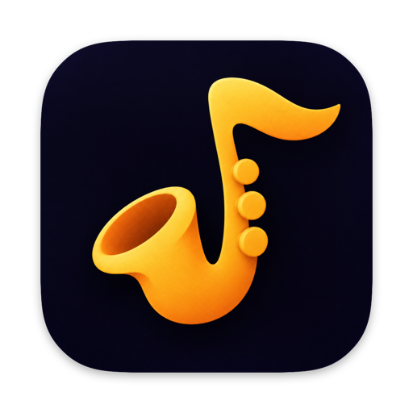
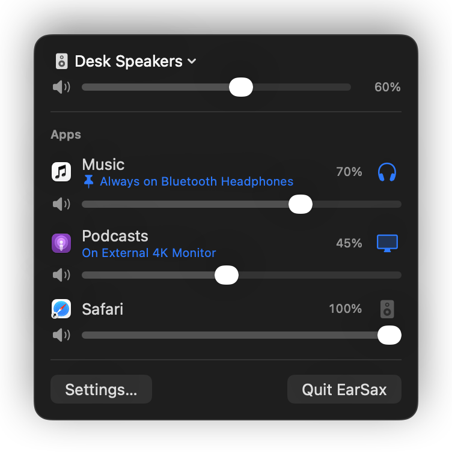
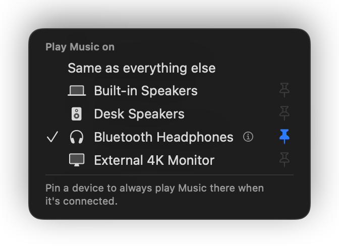

<p align="center"></p>

<h1 align="center">EarSax</h1>

<p align="center">
  <b>Every app gets its own volume, and its own speakers when you want.</b><br>
  A simple per-app volume mixer for the macOS menu bar.
</p>

<p align="center">
  <a href="https://github.com/Aratolotl/EarSax/releases"></a>
  
  
  <a href="LICENSE"></a>
  <a href="https://ko-fi.com/aratolotl"></a>
</p>

<p align="center">
  
  
</p>

EarSax does a few things and keeps them simple. One click sends everything to your headphones. One more sends a single app somewhere else. Nothing you didn't touch is changed.

## Install

- **Download:** get the latest `.dmg` from [Releases](https://github.com/Aratolotl/EarSax/releases), open it, and drag EarSax into Applications.
- **Homebrew:** coming once EarSax is notarized.

Requires macOS 26 or later on a Mac with Apple silicon.

> [!NOTE]
> Current releases are previews and aren't signed by Apple yet, so macOS asks once before opening EarSax. Open it, click **Done** on the warning, then go to **System Settings → Privacy & Security**, scroll to the message about EarSax, and click **Open Anyway**. Each new preview asks for the System Audio Recording permission again.

## Getting started

1. Open EarSax. Its speaker icon appears in the menu bar.
2. Click the icon, then **Continue**, then **Allow** when macOS asks for the System Audio Recording permission.
3. Play something. Each app that's playing gets its own row: drag its slider, or click the speaker to mute it.
4. To play one app somewhere else, click the device icon at the right of its row and pick a device. Click the pin next to a device to keep that app there.

## Features

### 🎚 Volume
- **Per-app volume and mute,** remembered for each app.
- **Main volume** for the current device, with mute.
- **Alert sounds:** the volume of macOS's alert sounds, right under your apps.
- **Untouched apps stay untouched:** an app at 100% plays exactly as it would without EarSax.

### 🔀 Where sound plays
- **Play everything on:** pick a device and every app moves there.
- **No gap when switching:** apps whose volume EarSax changes crossfade to the new device instead of cutting out.
- **One app elsewhere:** send a single app to another device, for now.
- **Pins:** pin a device and that app always plays there while it's connected. It follows your main output while the device is away, and goes back when it returns.
- **Low delay:** EarSax adds about 12 ms (measured on Bluetooth headphones).
- **Sound input:** with more than one microphone, pick which one the Mac uses from the row under the main volume.
- **Known limit:** while EarSax changes an app's volume, AirPods may not hand off to an iPhone on their own. Set that app back to 100% to let them.
- **Known limit:** when the Mac's output changes, some apps restart their own sound and pause for a moment (up to a few hundred milliseconds), as they do with macOS's own switch. EarSax's crossfade can't hide a pause inside the app.

### 🎙 Microphone
- **Bluetooth headphones keep their full sound:** when they connect, macOS also hands them the microphone, which makes everything they play sound muffled while an app listens. EarSax switches back to the microphone you used before. You can still pick the headphones' microphone yourself, and the behavior can be turned off in Settings.

### ⚙️ Settings
- **Default main volume:** when the output changes, a device that's too loud is turned down to your limit (75% to start). EarSax never turns a device up.
- **Hide devices** you never use, outputs and microphones alike. The virtual devices Zoom and Microsoft Teams install are hidden from the start.
- **Open at login,** and a quiet update check.

## Build from source

EarSax is a Swift package. With Xcode 26 or its command-line tools:

```bash
git clone https://github.com/Aratolotl/EarSax.git
cd EarSax
swift test
./build-app.sh
```

`build-app.sh` writes `build/EarSax.app`. It's signed only for your own Mac, so macOS asks for the System Audio Recording permission again after each build.

## Privacy

- macOS calls the permission EarSax needs "System Audio Recording". EarSax uses it only to change each app's sound as it plays. It never records or saves audio.
- Once a day, EarSax asks this page on GitHub whether a newer version exists. You can turn that off in Settings. There are no accounts and no analytics.

## License

EarSax is released under the [MIT License](LICENSE).

## Support EarSax

If EarSax is useful to you, you can [support it on Ko-fi](https://ko-fi.com/aratolotl).
